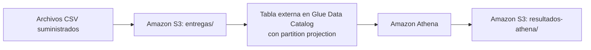

# Final-Entregas

## Reproducción de la entrega

Ejecuta los comandos desde la raíz del repositorio en PowerShell. Necesitas Terraform 1.5 o posterior, `uv` y credenciales de AWS con permisos para S3, Glue Data Catalog y Athena. Usa el mismo perfil y región en Terraform y en los scripts. Boto3 se instala para cada ejecución con `uv run --with boto3`.

1. Crea `infraestructura/terraform.tfvars` con un nombre de bucket globalmente único y la región del despliegue. La base de datos y el workgroup tienen como valores predeterminados `final_entregas` y `final-entregas`.

   ```hcl
   nombre_bucket = "reemplaza-por-un-nombre-globalmente-unico"
   region_aws    = "us-east-1"
   ```

2. Inicializa y valida Terraform. Genera el plan y revísalo antes de aplicar.

   ```powershell
   terraform -chdir=infraestructura init
   terraform -chdir=infraestructura fmt -check
   terraform -chdir=infraestructura validate
   terraform -chdir=infraestructura plan -out=entregas.tfplan
   ```

   ```powershell
   terraform -chdir=infraestructura apply -no-color entregas.tfplan 2>&1 |
     Tee-Object -FilePath evidencias/aplicacion_terraform.txt
   if ($LASTEXITCODE -ne 0) { throw 'Terraform apply falló.' }

   $salidas = terraform -chdir=infraestructura output -json
   if ($LASTEXITCODE -ne 0) { throw 'No se pudieron leer los outputs de Terraform.' }
   $salidas | Set-Content -Encoding utf8 evidencias/outputs.json
   ```

3. Ejecuta la etapa inicial. El script lee `evidencias/outputs.json`, carga solo los días 1 y 2 y guarda los tres resultados de Athena en `resultados/inicial/`. Compara esos resultados con los CSV de referencia antes de seguir.

   ```powershell
   uv run --with boto3 scripts/ejecutar_etapa_inicial.py
   ```

4. Ejecuta la etapa final. El script carga solo el día 3, verifica sus seis registros y las 18 filas de la tabla, y guarda los resultados en `resultados/final/`. Los dos scripts añaden los IDs de Athena y las rutas de los archivos a `evidencias/ejecuciones_athena.csv`. Si usaste una región distinta de `us-east-1`, pasa `--region <región>` a ambos scripts.

   ```powershell
   uv run --with boto3 scripts/ejecutar_etapa_final.py
   ```

5. Con los resultados y las evidencias descargados, ejecuta la limpieza desde el mismo repositorio, conservando el estado local y `infraestructura/terraform.tfvars`. Revisa el plan de destrucción y escribe `yes` cuando Terraform lo solicite. El bucket tiene `force_destroy = true`, por lo que se eliminan también sus objetos.

   ```powershell
   terraform -chdir=infraestructura destroy -no-color 2>&1 |
     Tee-Object -FilePath evidencias/eliminacion_terraform.txt
   if ($LASTEXITCODE -ne 0) { throw 'Terraform destroy falló. Revisa la evidencia.' }
   ```

## 1. Contexto del negocio y arquitectura

Una empresa de mensajería recibe archivos diarios con los resultados de los intentos de entrega de paquetes. El equipo de operaciones necesita consultar:

- La cantidad de intentos por fecha y estado.
- El porcentaje de entregas exitosas por fecha y ciudad.
- La duración promedio de las entregas exitosas para una fecha específica.

La empresa quiere consultar archivos de nuevas fechas desde Athena sin ejecutar crawlers ni registrar manualmente una partición por cada día.

Se debe implementar la siguiente arquitectura:



Los datos permanecen en S3. Glue conserva su esquema, ubicaciones y reglas de proyección. Athena usa esos metadatos para leer los CSV de S3 y escribe los resultados en otro prefijo del mismo bucket.

## 2. Material suministrado

Los tres archivos de entrada ya están preparados y disponibles localmente. Se deben utilizar sin modificar su contenido:

```text
data/entregas/
├── fecha=2026-10-01/entregas.csv
├── fecha=2026-10-02/entregas.csv
└── fecha=2026-10-03/entregas.csv

resultados_esperados/
├── intentos_por_fecha_estado_inicial.csv
├── intentos_por_fecha_estado_final.csv
├── porcentaje_exito_por_fecha_ciudad_inicial.csv
├── porcentaje_exito_por_fecha_ciudad_final.csv
└── duracion_promedio_2026-10-02.csv
```

Antes de comenzar el desarrollo, se debe preparar el repositorio de GitHub con la estructura indicada en la sección de entrega. En el `README.md` de ese repositorio se deben documentar los prerrequisitos y los pasos realizados durante el ejercicio. También se debe crear un `.gitignore` que excluya credenciales, archivos de estado de Terraform y la carpeta local `.terraform/`.

Los archivos de infraestructura, consultas y evidencias se deben crear a medida que se avance en las actividades. Los CSV de entrada y de `resultados_esperados/` ya se suministran y no se deben generar de nuevo.

Cada archivo de entrada tiene un encabezado y **seis registros de datos**: 18 registros en total. Son datos ficticios y deterministas, codificados en UTF-8 sin BOM, con separador coma y finales de línea LF. Los valores no contienen comas ni saltos de línea internos.

Una fila representa el resultado de un intento de entrega. Cada envío tiene un único intento registrado y su identificador es único entre los tres archivos. Hay exactamente dos ciudades (`Bogota` y `Medellin`) y dos transportadoras (`RutaNorte` y `RutaSur`). Cada día incluye ambas ciudades, ambas transportadoras y los tres estados. Hay tres intentos por ciudad y día, con al menos un éxito y un fallo en cada grupo.

### Diccionario de datos

El encabezado y el orden de las cinco columnas son:

```text
id_envio,ciudad,transportadora,estado,duracion_minutos
```

| Campo | Tipo en la tabla | Significado |
| --- | --- | --- |
| `id_envio` | Texto (`string`) | Identificador único del envío. Debe conservarse como texto. |
| `ciudad` | Texto (`string`) | Ciudad del intento de entrega. |
| `transportadora` | Texto (`string`) | Transportadora responsable del intento. |
| `estado` | Texto (`string`) | Resultado: `entregado`, `destinatario_ausente` o `direccion_incorrecta`. |
| `duracion_minutos` | Entero (`int`) | Duración positiva cuando el estado es `entregado` y `0` para los intentos fallidos. |

Solo `entregado` cuenta como éxito. Los otros dos estados corresponden a intentos fallidos y tienen duración `0`. **El promedio de duración se debe calcular solo con las entregas exitosas**, sin incluir esos ceros.

`fecha` **no es una columna de los CSV**. Se obtiene de la carpeta `fecha=yyyy-MM-dd` y se declara como clave de partición de tipo texto en el catálogo.

El tercer archivo se debe conservar localmente hasta la segunda etapa de la demostración. Primero se deben cargar solo los días 1 y 2. Después se debe cargar el día 3.

## 3. Partition projection: idea general

Guardar archivos en S3 y describirlos en el catálogo son operaciones distintas. S3 almacena los objetos y Glue Data Catalog conserva los metadatos que permiten interpretar sus columnas y localizar los datos. Con particiones tradicionales se registran en el catálogo los valores de cada partición y sus ubicaciones, por ejemplo mediante un crawler o una operación de alta de particiones.

Con partition projection, Athena calcula los valores de partición y sus ubicaciones durante la consulta a partir de reglas definidas en las propiedades de la tabla. Así puede localizar fechas dentro de la proyección sin registrar cada día individualmente. La [documentación oficial de Athena](https://docs.aws.amazon.com/athena/latest/ug/partition-projection.html) explica cómo funciona este mecanismo.

Para proyectar fechas, se debe definir cómo se representan y cuáles se pueden consultar. El **formato** indica cómo se escribe cada fecha. El **rango** fija la fecha inicial y la final, ambas incluidas. El **intervalo** y su unidad indican cuánto avanza cada paso, por ejemplo un día. Los detalles se encuentran en la documentación sobre [tipos admitidos y reglas de proyección de fechas](https://docs.aws.amazon.com/athena/latest/ug/partition-projection-supported-types.html).

Los archivos nuevos deben respetar la estructura de rutas y el esquema configurados. La proyección **no crea archivos ni garantiza que existan datos para cada fecha**. Una fecha proyectada puede no tener objetos en S3. Si se utiliza una plantilla de ubicación, esta describe el prefijo de la partición y debe terminar en `/`. El archivo se encuentra dentro de ese prefijo. La documentación sobre [configuración y ubicaciones personalizadas de S3](https://docs.aws.amazon.com/athena/latest/ug/partition-projection-setting-up.html) describe estos requisitos.

## 4. Infraestructura

El código Terraform se debe desarrollar en la carpeta `infraestructura/`, con la siguiente distribución:

| Archivo | Contenido esperado |
| --- | --- |
| `infraestructura/principal.tf` | Configuración de Terraform, proveedor AWS y definición de los recursos del ejercicio, incluidas las propiedades de partition projection. |
| `infraestructura/variables.tf` | Variables necesarias para configurar el despliegue. |
| `infraestructura/salidas.tf` | Outputs que identifican los recursos creados. |

Se deben definir y crear mediante Terraform los siguientes recursos:

1. **Un bucket S3 privado**, con bloqueo de acceso público. Se debe elegir un nombre disponible para el ejercicio.
2. **Prefijos separados** dentro de ese bucket: `entregas/` para los datos y `resultados-athena/` para los resultados de las consultas. Los prefijos son parte de las claves de los objetos y no requieren la creación previa de directorios físicos.
3. **Una base de datos de Glue Data Catalog**.
4. **Una tabla externa** en esa base de datos, compatible con los CSV suministrados, que cumpla todos estos requisitos:
   - Declare las cinco columnas del diccionario, en el orden entregado y con sus tipos correspondientes.
   - Interprete el separador coma y omita el encabezado de cada archivo al leer los registros.
   - Declare `fecha` como clave de partición de tipo texto (`string`), separada de las cinco columnas del archivo.
   - Habilite partition projection de fechas con intervalo de **un día**.
   - Use el formato **`yyyy-MM-dd`**.
   - Proyecte desde **`2026-10-01` hasta `2026-10-03`**, ambos incluidos, desde el despliegue inicial.
   - Resuelva los datos de cada fecha en `s3://<bucket>/entregas/fecha=<fecha>/entregas.csv`. Esta es la ruta del objeto: la ubicación de su partición corresponde al prefijo que lo contiene, terminado en `/`.
5. **Un workgroup de Athena** con la ubicación de resultados configurada en el prefijo `resultados-athena/` del bucket. Las consultas del ejercicio se deben ejecutar en este workgroup.
6. **Outputs** que permitan identificar el bucket, la base de datos, la tabla y el workgroup.

Toda la definición de infraestructura, el esquema de la tabla y las propiedades de proyección deben quedar en Terraform y ser reproducibles. No se aceptan ajustes realizados únicamente desde la consola. No se permite crear particiones individuales mediante Terraform.

La carga de archivos y la ejecución de consultas pueden hacerse mediante consola, CLI o un programa propio. No es obligatorio gestionar los objetos CSV mediante Terraform. Se deben respetar las dos etapas de carga. No se permite cargar toda la carpeta de forma recursiva ni utilizar un mecanismo que suba automáticamente los tres archivos.

### Documentación de consulta

Referencias para la tabla externa y el workgroup:

- [AWS: lectura de CSV y tratamiento de encabezados en Athena](https://docs.aws.amazon.com/athena/latest/ug/csv-serde.html).
- [Proveedor AWS de Terraform: tabla de Glue Data Catalog](https://registry.terraform.io/providers/hashicorp/aws/latest/docs/resources/glue_catalog_table).
- [Proveedor AWS de Terraform: workgroup de Athena](https://registry.terraform.io/providers/hashicorp/aws/latest/docs/resources/athena_workgroup).


## 5. Demostración inicial: días 1 y 2

Una vez desarrollado el código de `infraestructura/`, se debe aplicar y guardar la evidencia en `evidencias/aplicacion_terraform.txt`. Los outputs se deben guardar en `evidencias/outputs.json`. En el `README.md` de la entrega se deben documentar los pasos de despliegue y carga de archivos.

A continuación, se deben cargar **únicamente** estos archivos en sus rutas correspondientes:

| Archivo local | Objeto de destino |
| --- | --- |
| `data/entregas/fecha=2026-10-01/entregas.csv` | `s3://<bucket>/entregas/fecha=2026-10-01/entregas.csv` |
| `data/entregas/fecha=2026-10-02/entregas.csv` | `s3://<bucket>/entregas/fecha=2026-10-02/entregas.csv` |

En este momento deben poder consultarse **12 registros de datos**. Aunque el rango ya incluye el día 3, su archivo todavía no debe estar en S3.

Se deben desarrollar y ejecutar las siguientes consultas SQL:

1. **Cantidad de intentos por fecha y estado.** Se deben contar todos los intentos y ordenar los resultados por fecha y luego por estado, de forma ascendente. La consulta se debe guardar en `consultas/intentos_por_fecha_estado.sql`.
2. **Porcentaje de entregas exitosas por fecha y ciudad.** Se debe calcular `100 × entregas exitosas / total de intentos` dentro de cada grupo. El denominador debe incluir todos los estados. Se debe evitar la división entera y presentar el resultado con dos decimales, ordenado por fecha y luego por ciudad, de forma ascendente. La consulta se debe guardar en `consultas/porcentaje_exito_por_fecha_ciudad.sql`.
3. **Duración promedio de las entregas exitosas del 2 de octubre de 2026.** Se debe obtener un único promedio para esa fecha, considerando todas las ciudades y transportadoras. Solo se deben incluir intentos con estado `entregado` y el resultado se debe presentar con dos decimales. La consulta se debe guardar en `consultas/duracion_promedio_2026-10-02.sql`.

Se deben utilizar los nombres de columnas de salida definidos en la sección de resultados esperados. Los resultados iniciales se deben guardar y comparar con las siguientes referencias:

| Resultado obtenido en Athena | Referencia suministrada |
| --- | --- |
| `resultados/inicial/intentos_por_fecha_estado.csv` | `resultados_esperados/intentos_por_fecha_estado_inicial.csv` |
| `resultados/inicial/porcentaje_exito_por_fecha_ciudad.csv` | `resultados_esperados/porcentaje_exito_por_fecha_ciudad_inicial.csv` |
| `resultados/inicial/duracion_promedio_2026-10-02.csv` | `resultados_esperados/duracion_promedio_2026-10-02.csv` |

Cada ejecución se debe registrar en `evidencias/ejecuciones_athena.csv`, con las columnas `etapa`, `archivo_sql`, `id_ejecucion` y `archivo_resultado`. Para estas consultas, la etapa debe ser `inicial`. Las rutas de los archivos deben ser relativas a la raíz del repositorio.

## 6. Demostración de una nueva fecha: día 3

Sin modificar la infraestructura ni las propiedades de la tabla, se debe cargar el archivo local `data/entregas/fecha=2026-10-03/entregas.csv` en el objeto `s3://<bucket>/entregas/fecha=2026-10-03/entregas.csv`.

La incorporación de este día debe requerir **únicamente subir el archivo y consultar**. Durante esta demostración no se permite:

- Ejecutar crawlers.
- Usar `MSCK REPAIR TABLE`.
- Ejecutar `ALTER TABLE ADD PARTITION`.
- Crear particiones individuales mediante Terraform.
- Cambiar el rango ni ninguna otra propiedad de la tabla.

Se debe demostrar mediante consultas y evidencia de sus resultados:

1. Que están disponibles los seis registros de `2026-10-03` y que la tabla contiene ahora **18 registros** en total.
2. Que los conteos por estado de esa fecha son correctos.
3. Que las consultas agregadas de intentos y porcentaje de éxito incluyen el tercer día. Se deben ejecutar de nuevo sobre todo el rango del ejercicio y comparar los resultados con las referencias finales. Si la consulta inicial tenía un filtro de fechas, este se debe ampliar en el SQL para consultar los tres días sin cambiar la tabla.

Las consultas para verificar los seis registros del tercer día y el total de la tabla se deben guardar en `consultas/verificacion_tercer_dia.sql`. Los registros de esa fecha se deben guardar en `resultados/final/verificacion_tercer_dia.csv`. Si la verificación requiere otros resultados con columnas diferentes, se deben guardar en CSV separados dentro de `resultados/final/`.

Se deben volver a ejecutar `consultas/intentos_por_fecha_estado.sql` y `consultas/porcentaje_exito_por_fecha_ciudad.sql`, y guardar los resultados finales en los siguientes archivos:

| Resultado obtenido en Athena | Referencia suministrada |
| --- | --- |
| `resultados/final/intentos_por_fecha_estado.csv` | `resultados_esperados/intentos_por_fecha_estado_final.csv` |
| `resultados/final/porcentaje_exito_por_fecha_ciudad.csv` | `resultados_esperados/porcentaje_exito_por_fecha_ciudad_final.csv` |

El archivo de intentos permite comprobar también los conteos por estado del tercer día. Todas las nuevas ejecuciones se deben registrar en `evidencias/ejecuciones_athena.csv` con la etapa `final` y la ruta del resultado correspondiente. Los pasos de incorporación de la nueva fecha se deben documentar en el `README.md` de la entrega. El promedio solicitado sigue correspondiendo al día 2 y mantiene la misma referencia.

## 7. Resultados esperados

Los archivos de [resultados_esperados/](resultados_esperados/) se deben utilizar para comprobar los resultados de las consultas. **No se deben subir al prefijo `entregas/` en S3.** Los archivos con sufijo `inicial` incluyen únicamente el 1 y el 2 de octubre. Los de sufijo `final` incluyen los tres días.

| Archivos | Columnas de salida, en orden | Orden de filas |
| --- | --- | --- |
| `intentos_por_fecha_estado_inicial.csv` y `intentos_por_fecha_estado_final.csv` | `fecha`, `estado`, `total_intentos` | Fecha ascendente y luego estado en orden alfabético ascendente. |
| `porcentaje_exito_por_fecha_ciudad_inicial.csv` y `porcentaje_exito_por_fecha_ciudad_final.csv` | `fecha`, `ciudad`, `porcentaje_exito` | Fecha ascendente y luego ciudad en orden alfabético ascendente. |
| `duracion_promedio_2026-10-02.csv` | `fecha`, `duracion_promedio_minutos` | Una sola fila para `2026-10-02`. |

Los resultados deben utilizar los siguientes tipos y formatos:

- `fecha` con formato `yyyy-MM-dd`.
- `total_intentos` como un número entero.
- `porcentaje_exito` como un porcentaje de 0 a 100, sin el símbolo `%`.
- `duracion_promedio_minutos` como una duración en minutos.

Los porcentajes y promedios están redondeados a dos decimales y usan punto decimal. Los resultados entregados deben conservar esos dos decimales.

Los archivos de intentos tienen seis filas de datos en la etapa inicial y nueve en la final. Los de porcentajes tienen cuatro filas en la etapa inicial y seis en la final. El archivo de duración tiene una sola fila. No se esperan filas para fechas sin datos cargados.

## 8. Preguntas

Las [respuestas conceptuales](respuestas.md) relacionan las preguntas con la evidencia de la implementación:

1. ¿Por qué se pudo consultar el tercer día sin registrar una partición nueva?
2. Si se subiera un archivo para el 4 de octubre manteniendo la configuración actual, ¿qué resultado se esperaría y qué se debería modificar para incluirlo?

## 9. Entrega y limpieza

**La entrega se debe realizar en un repositorio de GitHub.** Se debe proporcionar el enlace del repositorio y garantizar que el docente tenga acceso para revisarlo.

El repositorio debe contener el material necesario para revisar y reproducir el trabajo:

- El código Terraform desarrollado, incluidas las variables necesarias y los outputs.
- Las consultas SQL de la demostración inicial y de la incorporación del tercer día.
- Instrucciones reproducibles con los prerrequisitos, región, configuración, despliegue, rutas y orden de carga, ejecución de consultas y limpieza.
- Evidencia de la aplicación de Terraform y de los outputs que identifican los recursos creados.
- Resultados e identificadores de ejecución de Athena antes y después de cargar el tercer día, identificando la consulta y la etapa a la que corresponde cada ejecución.
- Las respuestas a las preguntas conceptuales.
- Evidencia de eliminación de los recursos del ejercicio mediante Terraform.

La entrega se debe organizar con la siguiente estructura:

```text
repositorio-entrega/
├── README.md
├── .gitignore
├── infraestructura/
│   ├── principal.tf
│   ├── variables.tf
│   └── salidas.tf
├── consultas/
│   ├── intentos_por_fecha_estado.sql
│   ├── porcentaje_exito_por_fecha_ciudad.sql
│   ├── duracion_promedio_2026-10-02.sql
│   └── verificacion_tercer_dia.sql
├── resultados/
│   ├── inicial/
│   │   ├── intentos_por_fecha_estado.csv
│   │   ├── porcentaje_exito_por_fecha_ciudad.csv
│   │   └── duracion_promedio_2026-10-02.csv
│   └── final/
│       ├── intentos_por_fecha_estado.csv
│       ├── porcentaje_exito_por_fecha_ciudad.csv
│       └── verificacion_tercer_dia.csv
├── evidencias/
│   ├── aplicacion_terraform.txt
│   ├── outputs.json
│   ├── ejecuciones_athena.csv
│   └── eliminacion_terraform.txt
└── respuestas.md
```

El `README.md` de la entrega debe contener las instrucciones reproducibles. En `infraestructura/` se debe incluir el código Terraform y en `consultas/` el SQL desarrollado. La verificación del tercer día debe incluir sus seis registros, los conteos por estado y el total de 18 registros de la tabla.

En `resultados/` se deben guardar los resultados obtenidos en Athena, separados por etapa. Esta carpeta es distinta de `resultados_esperados/`, que contiene las referencias suministradas. Las carpetas `data/` y `resultados_esperados/` se pueden conservar junto a la estructura de entrega.

El archivo `evidencias/ejecuciones_athena.csv` debe relacionar cada ejecución con las columnas `etapa`, `archivo_sql`, `id_ejecucion` y `archivo_resultado`. Las etapas se deben identificar como `inicial` o `final`, y las rutas deben ser relativas a la raíz del repositorio. Se pueden incluir archivos de verificación adicionales si se necesitan varias consultas para la demostración.

En `evidencias/` se deben guardar también las salidas de la aplicación de Terraform, los outputs y la eliminación de recursos. Las respuestas conceptuales deben quedar en `respuestas.md`. El archivo `.gitignore` debe excluir las credenciales, los archivos de estado y la carpeta local `.terraform/`.

La limpieza se realiza con el comando del paso 5 de [Reproducción de la entrega](#reproducción-de-la-entrega). Guarda primero los resultados y las evidencias locales.

No se deben publicar credenciales ni archivos de estado de Terraform. Estos archivos deben quedar por fuera del repositorio y de la entrega.
