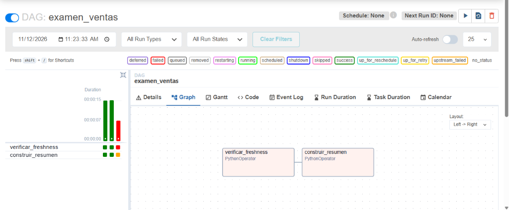

# Evidencias del examen Final-Ventas

## 1. ¿Por qué usar `_loaded_at` y no `fecha_venta`?

`fecha_venta` indica el día en que ocurrió la venta. `_loaded_at` registra cuándo se incorporó técnicamente el dato a la fuente. dbt compara el valor máximo de `_loaded_at` con la hora de la comprobación para medir cuánto tiempo ha pasado desde la última carga registrada.

Una carga reciente puede incorporar ventas de días anteriores, por ejemplo, al recuperar datos pendientes. En ese caso, la última `fecha_venta` puede seguir siendo antigua aunque la ingesta acabe de completarse. Durante un fin de semana o un día sin ventas, la fecha de negocio también puede permanecer igual. Usarla como reloj de ingesta confundiría una pausa en la actividad comercial con un retraso en la carga.

## 2. ¿Por qué las pruebas de integridad no garantizan actualidad?

`unique` comprueba que los valores de la columna evaluada no se repitan y `not_null` comprueba que esa columna no contenga valores nulos. Ambas pruebas evalúan las filas presentes al momento de ejecutarse. Una tabla congelada durante varios días puede seguir pasando el 100 % de sus pruebas de integridad si esas filas conservan identificadores únicos y campos obligatorios completos. Incluso un `_loaded_at` no nulo puede contener una marca antigua. La comprobación de freshness añade la comparación temporal con los umbrales definidos.

## Evidencia de Airflow



| Escenario | `verificar_freshness` | `construir_resumen` |
| --- | --- | --- |
| Actualizada | `success` | `success` |
| Desactualizada | `failed` | `upstream_failed` |

## Log resumido del escenario desactualizada

Ejecución de Airflow: `manual__2026-11-12T11:23:30.501993+00:00`.

- `verificar_freshness` registró `INICIO dbt ['source', 'freshness']`.
- En este escenario, la última carga de `ventas_raw.ventas` se preparó con una antigüedad aproximada de 30 horas. Esa antigüedad supera el umbral de error de 24 horas.
- Airflow registró `Task exited with return code 1` y marcó `verificar_freshness` como `failed`. La dependencia con la regla `all_success` dejó `construir_resumen` en `upstream_failed`, sin ejecutar el build.

## Resumen diario antes y después del bloqueo

```sql
select *
from analytics.ventas_diarias
order by fecha_venta;
```

La consulta realizada después del escenario actualizado y repetida tras el fallo devolvió las mismas tres filas. La consulta posterior se verificó directamente en DuckDB.

| `fecha_venta` | `numero_ventas` | `unidades_vendidas` | `ingreso_total` |
| --- | ---: | ---: | ---: |
| 2026-01-10 | 2 | 3 | 46.00 |
| 2026-01-11 | 3 | 6 | 51.25 |
| 2026-01-12 | 1 | 4 | 12.40 |

La igualdad de las filas confirma que el contenido del resumen se conservó. El estado `upstream_failed` en Airflow confirma que el build quedó bloqueado en esa ejecución.
